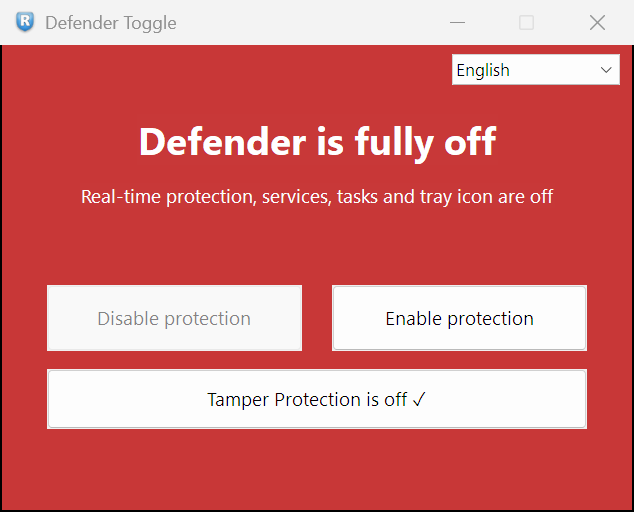
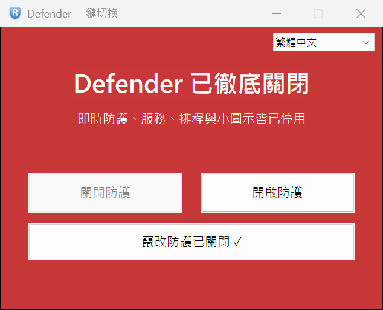

<div align="center">


# defender-toggle

**A tiny, one-click switch to turn Microsoft Defender off and back on — fully reversible.**

[](LICENSE)


-f7a41d)

</div>

> [!WARNING]
> This tool disables your antivirus. Turning Microsoft Defender off lowers your
> system's protection. Use it only on machines you control and understand the
> risk for. Everything it does is reversible — but **use at your own risk**.

<p align="center">
  
  
</p>

---

## Why another one?

Most "Defender removers" **permanently rip Defender out** of Windows, and there is
no clean way back. `defender-toggle` takes the opposite approach: it **leaves every
file in place** and simply flips Defender **off** or **on** with one click, so you
can always restore full protection. It is a *switch*, not a *remover*.

It is a ~120 KB native Win32 app with **no C runtime**, no installer, and no
background service.

## Features

- **One-click toggle** — a single window with *Disable* / *Enable* buttons.
- **Fully reversible** — restores policies, services, scheduled tasks and the
  tray icon to their original state.
- **Live status panel** — green = protected, red = fully off, amber = waiting for
  a restart / partially applied.
- **Handles the parts Windows locks at runtime** — some Defender service settings
  cannot be changed while Windows is running. The tool schedules a **one-time
  offline pass** (a WinRE image built once from your own PC + a hidden, one-shot
  boot entry) that applies them on the next restart, automatically, then boots
  straight back into Windows. A backup of your boot configuration is exported
  first.
- **Multi-language** — opens in your Windows display language, with a menu to
  switch at any time: English, 繁體中文, 日本語, 한국어, Español, Français, Deutsch,
  Русский, Português. Other languages open in English; Simplified Chinese opens in
  Traditional Chinese. Non-English/Chinese translations have not yet been reviewed
  by native speakers — corrections to `lang.h` are welcome.
- **Tiny & self-contained** — freestanding build, single `.exe`, runs as admin
  via an embedded manifest.

## How it works

**Disable** sets the documented Defender **Group Policy** keys, turns off
real-time protection via `Set-MpPreference`, sets the Defender **services** to
disabled, disables the four Defender **scheduled tasks**, and removes the
Security tray icon from startup.

Because a few service `Start` values are protected by Defender's own kernel
callbacks while Windows is running, those are applied **offline** on the next
reboot through a small WinRE-based boot entry the tool prepares on first use.

**Enable** reverses all of the above and restores the original values.

> Microsoft locks **Tamper Protection** so that *no* program can change it.
> You must turn it off manually first:
> *Windows Security → Virus & threat protection → Manage settings → Tamper Protection → Off.*

## Usage

1. Download the latest `defender-toggle.exe` from [Releases](../../releases), or build
   it yourself (see below).
2. Turn **Tamper Protection** off (see note above).
3. Run it (it will prompt for administrator rights).
4. Click **Disable protection** or **Enable protection**. If a restart is needed,
   the window tells you and offers to restart.

## Configuration

By default the offline helper data lives in `C:\DefenderOffline`. To put it on a
different drive (for example if `C:` is small), set an environment variable
**before launching** — the app reads it at startup:

```powershell
setx DEFENDER_OFFLINE_DIR "D:\DefenderOffline"
```

It must be a folder at the root of a fixed, internal NTFS drive, with an
ASCII-only path. (On reboot the offline step runs inside WinRE, where drive
letters can differ, so the folder is located by scanning drives — it must sit at
a drive root.)

## Building

Requires [Zig](https://ziglang.org) only (tested with **0.13.0**) — no Visual
Studio, no C runtime.

```powershell
# put `zig` on PATH, or set $env:ZIG to zig.exe
pwsh -File build.ps1
```

This produces `defender_gui.exe`. The offline helper scripts in `offline/` are
embedded into the binary as resources at build time.

## FAQ

**"Windows protected your PC" / SmartScreen warning.** The released binary is
not code-signed, so SmartScreen shows a warning on first run — click *More info →
Run anyway*. If you'd rather not trust a binary, build it yourself from source.

**My antivirus flags the download.** Tools that disable Defender are commonly
flagged as riskware. The SHA-256 of each release is published in its release
notes so you can verify the download; or build from source.

**Does it work on every Windows version?** Developed and tested on Windows 11.
Older builds are untested — the offline mechanism depends on WinRE being present.

**Is removal permanent?** No. That is the whole point — press *Enable* (and
restart if asked) to get full protection back.

## Disclaimer

This project is **not affiliated with, endorsed by, or sponsored by Microsoft**.
"Windows", "Microsoft" and "Microsoft Defender" are trademarks of Microsoft
Corporation, used here only to describe what the tool interoperates with.
The icon and all code are original work released under the MIT License.

## License

[MIT](LICENSE) © 2026 ArtaleTools
